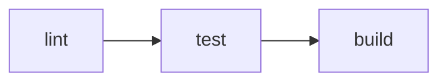

# 运行

`vp run` 运行 `package.json` 脚本和 `vite.config.ts` 中定义的任务。它的工作方式类似于 `pnpm run`，内置缓存、依赖顺序和工作区感知执行功能。任务运行器可通过[全局 CLI](/guide/global-cli)和[项目本地 CLI](/guide/local-cli)使用。

::: tip
`vpr` 是 `vp run` 的独立简写形式。以下所有示例都适用于 `vp run` 和 `vpr`。
:::

::: info
Vite Task 会自行解析简单命令和 `&&` 链，而不会将它们交给 shell，因此它们在各个平台上的行为一致。管道符或重定向等其他 shell 语法在不同平台上的行为可能不同。
:::

## 概述

使用 `vp run` 执行现有的 `package.json` 脚本：

```json [package.json]
{
  "scripts": {
    "build": "node compile-legacy-app.js",
    "test": "jest"
  }
}
```

`vp run build` 执行对应的构建脚本：

```
$ node compile-legacy-app.js

为生产环境构建旧版应用...

✓ 构建完成，用时 69 秒
```

不指定任务名称直接运行 `vp run` 可进入交互式任务选择器：

```
Select a task (↑/↓, Enter to run, type to search):

  › build: node compile-legacy-app.js
    test: jest
```

启用 [shell 补全](/guide/env#shell-completion) 后，在 `vp run ` 或 `vpr ` 后按 Tab，可补全项目中的任务名称。

## 内置命令与脚本

`vp dev` 是内置命令。`vp run dev` 是你的 `dev` 脚本。内置命令无法被覆盖，因此添加 `dev` 脚本不会改变 `vp dev` 的行为：

| 命令                       | 执行内容                                                                  |
| -------------------------- | ------------------------------------------------------------------------- |
| `vp dev`                   | 内置的 Vite 开发服务器                                                    |
| `vp run dev` / `vpr dev`   | `package.json` 中的 `dev` 脚本，或 `vite.config.ts` 中的 `dev` 任务        |
| `vp test`                  | 内置的 Vitest 命令                                                         |
| `vp run test` / `vpr test` | `package.json` 中的 `test` 脚本，或 `vite.config.ts` 中的 `test` 任务      |

`build`、`preview`、`lint`、`fmt`、`check` 和 `pack` 的工作方式相同。

如果项目定义了相应的脚本或任务，请使用 `vp run <name>` 运行它。例如，对于 `"dev": "astro dev"` 脚本，`vp run dev` 会启动 Astro，而 `vp dev` 会忽略该脚本并启动 Vite。

## 缓存

默认情况下不会缓存 `package.json` 脚本。使用 `--cache` 启用缓存：

```bash
vp run --cache build
```

```
$ node compile-legacy-app.js
✓ 构建完成，用时 69 秒
```

如果没有变化，下次运行时输出会从缓存中重放：

```
$ node compile-legacy-app.js ◉ cache hit, replaying
✓ built in 69s

---
vp run: 命中缓存，节省了 69 秒。
```

如果有输入发生变化，任务会重新运行：

```
$ node compile-legacy-app.js ○ cache miss: 'legacy/index.js' modified, executing
```

## 任务定义

Vite 任务[自动跟踪](/guide/automatic-data-tracking)每个任务进行缓存所需的内容。您可以直接在 `vite.config.ts` 中定义任务，以默认启用缓存，或者控制哪些文件和环境变量会影响缓存行为。

```ts [vite.config.ts]
import { defineConfig } from 'vite-plus';

export default defineConfig({
  run: {
    tasks: {
      build: {
        command: 'vp build',
        dependsOn: ['lint'],
        cache: {
          env: ['NODE_ENV'],
        },
      },
      deploy: {
        command: 'deploy-script --prod',
        cache: false,
        dependsOn: ['build', 'test'],
      },
    },
  },
});
```

如果您想直接运行现有的 `package.json` 脚本，请使用 `vp run <script>`。如果您需要任务级别的缓存、依赖关系或环境/输入控制，请使用显式的 `command` 定义任务。任务名称可以来自 `vite.config.ts` 或 `package.json`，但不能同时来自两者。

::: info
在 `vite.config.ts` 中定义的任务默认启用缓存。`package.json` 脚本则不会。完整的解析顺序请参见[何时启用缓存？](/guide/cache#when-is-caching-enabled)。
:::

完整的 `run` 块参考请参见[运行配置](/config/run)。

## 任务依赖

使用[`dependsOn`](/config/run#dependson)以正确顺序运行任务。使用上面的配置运行 `vp run deploy` 时，会先运行 `build` 和 `test`。

`dependsOn` 中的字符串任务名引用当前包或另一个包中的任务：

```ts [vite.config.ts]
dependsOn: [
  'build', // 同一包
  '@my/core#build', // 另一个包
];
```

当你需要引用当前包依赖项中所有具有给定名称的任务时，请使用对象形式：

```ts [vite.config.ts]
import { defineConfig } from 'vite-plus';

export default defineConfig({
  run: {
    tasks: {
      test: {
        command: 'vp test',
        dependsOn: [{ task: 'build', from: 'dependencies' }],
      },
    },
  },
});
```

在这个示例中，`vp run test` 会检查当前包的 `dependencies`。对于每个直接的 workspace 依赖项中定义了 `build` 的包，Vite Task 会在 `test` 之前运行该依赖项的 `build` 任务。

当你需要多个依赖字段时，请使用数组：

```ts [vite.config.ts]
dependsOn: [{ task: 'build', from: ['dependencies', 'devDependencies'] }];
```

## 在 Workspace 中运行

不带包选择标志时，`vp run` 会在当前工作目录所在的包中运行任务：

```bash
cd packages/app
vp run build
```

你也可以从任何位置显式指定目标包：

```bash
vp run @my/app#build
```

工作区包的顺序基于各包 `package.json` 中声明的常规单体仓库依赖关系图。换句话说，当 Vite+ 提及包依赖时，指的是工作区包之间的常规 `dependencies` 关系，而不是与任务运行器相关的独立图谱。

### 递归（`-r`）

按依赖顺序在每个工作区包中运行任务：

```bash
vp run -r build
```

该依赖顺序来自通过 `package.json` 依赖引用的工作区包。

### 传递（`-t`）

在一个包及其所有依赖项中运行任务：

```bash
vp run -t @my/app#build
```

如果 `@my/app` 依赖于 `@my/utils`，而 `@my/utils` 又依赖于 `@my/core`，则会按顺序运行这三个包。Vite+ 会从 `package.json` 中声明的正常工作区包依赖关系解析这个链。

### 过滤（`--filter`）

按名称、目录或通配符模式选择包。语法与 pnpm 的 `--filter` 相同：

```bash
# 按名称
vp run --filter @my/app build

# 按通配符
vp run --filter "@my/*" build

# 按目录
vp run --filter ./packages/app build

# 包含依赖项
vp run --filter "@my/app..." build

# 包含被依赖项
vp run --filter "...@my/core" build

# 排除包
vp run --filter "@my/*" --filter "!@my/utils" build
```

多个 `--filter` 标志会合并为并集。排除过滤器在所有包含之后应用。

当某个 `--filter` 没有匹配到任何包时，Vite+ 会打印警告并正常退出。若希望在任意过滤器未匹配到内容时中止运行，请传入 `--fail-if-no-match`。

### 工作区根包（`-w`）

显式在工作区根包中运行任务：

```bash
vp run -w build
```

## 复合命令 {#compound-commands}

用 `&&` 连接的命令会被拆分为独立的子任务，除非它们还使用了其他 shell 语法。启用缓存时，每个子任务会单独缓存。这适用于 `vite.config.ts` 任务和 `package.json` 脚本：

```json [package.json]
{
  "scripts": {
    "check": "vp lint && vp build"
  }
}
```

现在运行 `vp run --cache check`：

```
$ vp lint
发现 0 个警告和 0 个错误。

$ vp build
✓ 构建完成，用时 28 毫秒

---
vp run: 0/2 cache hit (0%), 2/2 successful.
```

每个子任务都有独立的缓存条目。例如，如果只供构建使用的文件（如 `index.html`）发生变化，则下次运行 `vp run --cache check` 时只会重新运行构建：

```
$ vp lint ◉ cache hit, replaying
$ vp build ○ cache miss: 'index.html' modified, executing
✓ built in 30ms

---
vp run: 1/2 cache hit (50%), 2/2 successful, 120ms saved.
```

### 环境变量前缀

环境变量前缀（例如 `FOO=bar command`）在所有平台上都有效，无需 `cross-env` 等额外工具：

```json [package.json]
{
  "scripts": {
    "build": "NODE_ENV=production node build.js"
  }
}
```

前缀只对其直接修饰的命令生效。在 `FOO=1 a && b` 中，`FOO` 只会为 `a` 设置，不会传给 `b`。

::: warning
命令同时使用其他 shell 语法时，前缀可能无法在所有平台正常工作。
:::

### 嵌套的 `vp run`

当命令包含 `vp run` 时，Vite 任务会将其内联为独立任务，而不是生成嵌套进程。每个子任务独立缓存，输出保持扁平化：

```json [package.json]
{
  "scripts": {
    "ci": "vp run lint && vp run test && vp run build"
  }
}
```

运行 `vp run ci` 会展开为三个任务：



标志也适用于嵌套脚本。例如，脚本中的 `vp run -r build` 会展开为每个包的独立构建任务。

::: info
单体仓库中常见的模式是在根脚本中递归运行任务：

```json [package.json (root) ~vscode-icons:file-type-node~]
{
  "scripts": {
    "build": "vp run -r build"
  }
}
```

这可能导致递归：根 `build` -> `vp run -r build` -> 包含根 `build` -> ...

Vite Task 会检测到这种情况并自动剪枝自引用，确保其他包正常构建。
:::

## 执行摘要

使用 `-v` 显示详细的执行摘要：

```bash
vp run -r -v build
```

```
━━━━━━━━━━━━━━━━━━━━━━━━━━━━━━━━━━━━━━━━━━━━━━━
    Vite+ 任务运行器 • 执行摘要
━━━━━━━━━━━━━━━━━━━━━━━━━━━━━━━━━━━━━━━━━━━━━━━

统计信息：   3 个任务 • 3 次命中缓存 • 0 次未命中缓存
性能：  100% 命中缓存率，总计节省 468 毫秒

任务详情：
────────────────────────────────────────────────
  [1] @my/core#build: ~/packages/core$ vp build ✓
      → 命中缓存 - 输出已重放 - 节省 200 毫秒
  ·······················································
  [2] @my/utils#build: ~/packages/utils$ vp build ✓
      → 命中缓存 - 输出已重放 - 节省 150 毫秒
  ·······················································
  [3] @my/app#build: ~/packages/app$ vp build ✓
      → 命中缓存 - 输出已重放 - 节省 118 毫秒
━━━━━━━━━━━━━━━━━━━━━━━━━━━━━━━━━━━━━━━━━━━━━━━
```

缓存未命中的任务摘要会列出导致未命中的所有更改。使用 `-vv`（或 `--verbose --verbose`）还可在 `Unchanged:` 下查看每次缓存运行中未变化的输入，并在 `Outputs:` 下查看缓存命中时会恢复的文件。如果某次运行命中了你预期会未命中的缓存，`-vv` 会显示你编辑的文件是否属于输入。

使用 `--last-details` 可在不重新运行任务的情况下显示上次运行的摘要：

```bash
vp run --last-details
```

## 试运行与 JSON 输出

`--dry-run` 会显示运行计划而不执行任何操作。它会打印每个命令及其缓存状态，然后显示摘要。Vite Task 会像实际运行一样检查缓存，但不会写入任何内容：

```bash
vp run --dry-run -r build
```

`--json` 会输出 JSON 而非文本，方便脚本和代理使用：

- 单独使用 `vp run --json`（不带任务或其他标志）时，会列出工作区中的所有包和任务，解析每项任务的 `dependsOn`，但不会运行任务。参见[任务图 schema](https://github.com/voidzero-dev/vite-task/blob/cb1ea8d214b26a0f3ca2b2ef3b6bc471b18ffacb/crates/vt/schemas/task-graph.json)。
- `vp run --dry-run --json build` 会输出运行计划：将运行的任务、各任务依赖的任务、每个步骤的命令，以及每个步骤是否会命中缓存。指定任务时，`--json` 只能与 `--dry-run` 一起使用。参见[运行计划 schema](https://github.com/voidzero-dev/vite-task/blob/cb1ea8d214b26a0f3ca2b2ef3b6bc471b18ffacb/crates/vt/schemas/run-plan.json)。

添加 `-v` 或 `-vv` 可查看更多详情：

- 单独使用 `--dry-run` 时，每个缓存未命中项会显示找到的第一个变化。使用 `-v` 时，摘要会列出所有变化。
- `--dry-run --json` 与 `-vv` 一起使用时，会在每个步骤中添加 `baseline.fingerprint` 和 `baseline.outputs`：前者是缓存运行记录的输入，后者是缓存命中时会恢复的输出。

请将这些标志放在任务名称之前。任务名称之后的内容会传给任务。

## 并发

默认情况下，最多同时运行 4 个任务。使用 `--concurrency-limit` 更改此限制：

```bash
# 一次最多运行 8 个任务
vp run -r --concurrency-limit 8 build

# 一次只运行一个任务
vp run -r --concurrency-limit 1 build
```

限制也可以通过环境变量 `VP_RUN_CONCURRENCY_LIMIT` 设置。`--concurrency-limit` 标志优先于环境变量。

### 并行模式

使用 `--parallel` 忽略任务依赖关系并以无限制的并发运行所有任务：

```bash
vp run -r --parallel dev
```

这在任务相互独立且需要最大吞吐量时非常有用。可以将 `--parallel` 与 `--concurrency-limit` 结合使用，以在不依赖顺序的情况下运行任务，但仍限制并发任务数：

```bash
vp run -r --parallel --concurrency-limit 4 dev
```

## 附加参数

任务名称之后的参数将传递给任务命令：

```bash
vp run test --reporter verbose
```
